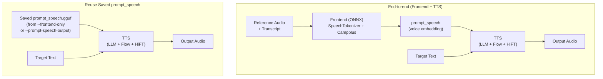

# CosyVoice.cpp

[](LICENSE)
[]()
[](https://github.com/Lourdle/cosyvoice.cpp/releases)
[](https://github.com/Lourdle/cosyvoice.cpp/actions/workflows/build-release.yml)

Language: English | [简体中文](README_zh.md)

> Unofficial project notice: this repository is **not** affiliated with, endorsed by, or maintained by the official CosyVoice team. It is a community-maintained C++/GGML port created by an independent developer.

> **Current status notice:** CPU, CUDA, Metal, Vulkan, and SYCL backends are currently working. Please review [Backend Test Status](#backend-test-status) before production use.

C++/GGML port of the Python CosyVoice inference pipeline, currently focused on **CosyVoice3**.

Supports **zero-shot**, **instruct**, and **cross-lingual** TTS modes with both synchronous and **streaming** output. The frontend pipeline (speech tokenizer + speaker embedding) handles reference audio processing, or pre-encoded `prompt_speech` can be reused across sessions to skip the ONNX frontend entirely.

This project provides:
- A core C/C++ inference library (`cosyvoice`)
- A CLI synthesis tool (`cosyvoice-cli`)
- An OpenAI Speech-compatible API server with embedded WebUI (`cosyvoice-server`)
- A GGUF quantization tool (`quantize`)

## Contents
- [Features](#features)
- [Quick Start](#quick-start)
- [Basic Usage](#basic-usage)
- [Pre-converted Models](#pre-converted-models)
- [Inference Pipeline](#inference-pipeline)
- [Backend Test Status](#backend-test-status)
- [Troubleshooting](#troubleshooting)
- [Documentation](#documentation)
- [AI Usage Disclosure](#ai-usage-disclosure)
- [Third-Party Notices](#third-party-notices)
- [Licensing](#licensing)
- [Contributing](#contributing)

## Features

| Feature | Description |
|---|---|
| **OpenAI Speech API Server** | Drop-in compatible `POST /v1/audio/speech` endpoint with multi-voice, auth, and CORS support — includes an embedded **WebUI** for model/speaker management and TTS generation |
| **WebUI Dashboard** | Modern browser-based interface for loading/unloading models, registering speakers (via GGUF/audio extraction/mic recording), TTS generation with live playback, history, and full sampling control |
| **Interactive REPL** | CLI interactive mode with slash commands for play, save, list, query, and seed control |
| **Concurrent Serving** | Server `--concurrency` for parallel request handling |
| **Inference Interruption** | Press `Ctrl+C` in CLI or disconnect from the server to stop generation as soon as possible — output up to that point remains valid |
| **Model Quantization** | Quantize GGUF models to smaller formats (Q2_K through F16) with the built-in `quantize` tool |
| **Streaming TTS** | Real-time speech generation with low-latency audio delivery via callback — delivers audio chunks as they are synthesized, before the full utterance completes |
| **DiT KV Cache** | Reuses attention key/values of already-emitted positions per diffusion step during streaming, so each new chunk computes only its fresh positions — configurable fixed (device), offloadable (CPU), and uncached slot categories to trade memory vs. speed |
| **Flash Attention** | LLM and Flow flash attention support (`--llm-flash-attn`, `--flow-flash-attn`) for reduced memory and faster inference when the backend supports it |
| **Chunk Tokens Control** | Tune streaming latency vs. overhead tradeoff via `--chunk-tokens` — smaller chunks reduce first-chunk latency, larger chunks reduce RTF |
| **KV Cache Quantization** | Reduce LLM memory usage via `--llm-kv-cache-type` (f32 / f16 / q8_0 / q5_1 / q4_0 / ...). Supports asymmetric quantization with separate K/V types (e.g. `k=q8_0,v=q4_0`). |
| **Prompt Speech Reuse** | Pre-encode reference voice once, reuse across multiple synthesis runs — no ONNX overhead |
| **Audio Backend Plugins** | Choose MINIAUDIO (default) or FFMPEG for multi-format encoding (WAV, MP3, AAC, FLAC, OPUS, M4A) |
| **UMA Detection** | Detects unified memory architecture and reports the result (e.g. `uma: yes/no`) for reference; does not alter buffer policy |
| **Inference Buffer Policies** | `shared` / `balanced` / `dedicated` buffer modes to trade off memory vs. throughput |
| **Text Splitting & Fade-in** | Smart text splitting for long inputs and configurable output fade-in postprocessing |
| **Multiple Backends** | CPU, CUDA, Metal, Vulkan, SYCL (see [Backend Test Status](#backend-test-status)) |
| **Adaptive SIMD Dispatch** | CPU DSP hot paths are compiled into per-ISA tiers (scalar, SSE4.2, AVX, AVX2+FMA3, AVX-512, AVX10.1) and selected at runtime — see [docs/SIMD.md](docs/SIMD.md) |
| **Cross-Platform** | Windows (x64), Linux (x86_64), macOS (arm64) — all tested in CI |

## Quick Start

### Pre-built Releases

On every platform a release contains the `cosyvoice` binaries and the frontend/audio dependencies, but **never** GGML — that comes from a `llama.cpp` release:
1. Download `cosyvoice-cli` or `cosyvoice-server` from this repository's [Releases page](https://github.com/Lourdle/cosyvoice.cpp/releases).
2. Download a `llama.cpp` release that matches your hardware and OS and ships **GGML 1.x** (releases built after GGML v1.0.0, 2026-11-13).
3. Copy **all** GGML libraries from that release into the same directory as the `cosyvoice` executables — `ggml*.dll` / `libggml*.so*` / `libggml*.dylib`, **including the CPU variant modules** (`ggml-cpu-<isa>.dll`, `libggml-cpu-<isa>.so`). Backends are discovered at runtime from the executable's directory, so omitting the variants leaves the binaries without a CPU backend.
4. Run from that directory. On macOS copy the dylibs with `cp -a` (or extract the archive) so the versioned symlink chain stays intact — `libggml.dylib` is a symlink to `libggml.<version>.dylib`.

Sanity check: run `cosyvoice-cli --list-backends`. It prints the backends that were actually loaded from that directory, and the names it prints are what `--backend` accepts. An empty list — or a list without your GPU backend — means the GGML libraries are in the wrong place or too old.

> **System libraries:** the `icu=ON` and `audio=FFMPEG` variants link `libicuuc`/`libicui18n` and `libav*`/`libswresample` dynamically, and those are stripped from the archive — install them (or drop them in next to the executables). The `no_icu`, `miniaudio` and `no_audio` variants need nothing beyond GGML.

> **GGML version requirement:** use the GGML libraries from a `llama.cpp` release that ships **GGML 1.x** (built after GGML v1.0.0, 2026-11-13). GGML 1.0 pruned the deprecated public API and bumped the library SONAME to 1 (`libggml.so.1` / `libggml.1.dylib`), so 0.x libraries are incompatible: on Linux/macOS they fail to load (SONAME mismatch), and on Windows they load but dispatch ops incorrectly — GGML 1.0 removed legacy op enum entries, shifting the remaining op values — which crashes or produces garbage output. This also covers the older macOS Metal requirement — the `GGML_OP_PAD` kernel must support beg (left) padding, which upstream added in [ggml-org/llama.cpp#29561](https://github.com/ggml-org/llama.cpp/pull/29561) and which every 1.x build includes.

> **Known issue with pre-built GGML CUDA backend (Issue [#15](https://github.com/Lourdle/cosyvoice.cpp/issues/15)):** Some users have reported noise in generated audio when using pre-built GGML binaries from `llama.cpp` releases with the CUDA backend. Testing confirmed this issue with pre-compiled GGML CUDA builds, while self-compiled GGML from source did not exhibit the problem. If you encounter noise when using the CUDA backend with pre-built GGML, we recommend building both this project and GGML from source. Alternatively, use the **Vulkan backend** — it works with the pre-built GGML releases out of the box.

### Build from Source

```bash
cmake -B build -DCMAKE_BUILD_TYPE=Release
cmake --build build --config Release
```

Outputs in `build/bin` (executables) and `build/lib` (libraries). See [docs/BUILD.md](docs/BUILD.md) for detailed options, server-specific requirements, and backend configuration.

## Basic Usage

```bash
# Zero-shot TTS via frontend + TTS in one command
cosyvoice-cli --model model.gguf \
  --speech-tokenizer speech_tokenizer.onnx --campplus campplus.onnx \
  --prompt-audio ref.wav --prompt-text "ref text" \
  --text "target text" --output out.wav

# Reuse a pre-encoded prompt_speech (skip the ONNX frontend)
cosyvoice-cli --model model.gguf --prompt-speech prompt_speech.gguf \
  --text "hello" --output out.wav

# Prepare a prompt_speech for later reuse
cosyvoice-cli --frontend-only --speech-tokenizer speech_tokenizer.onnx \
  --campplus campplus.onnx --prompt-audio ref.wav \
  --prompt-text "ref text" --prompt-speech-output prompt_speech.gguf

# Interactive mode
cosyvoice-cli --model model.gguf --prompt-speech prompt_speech.gguf --interactive

# OpenAI-compatible API server with WebUI
cosyvoice-server --model model.gguf \
  --voice-prompt alloy=prompt_alloy.gguf --host 0.0.0.0 --port 8080

# Quantize a GGUF model
quantize -f model.gguf -o model-q4k.gguf -t Q4_K
```

Full commands, options, and examples are documented in [docs/TOOLS.md](docs/TOOLS.md).

## Pre-converted Models

Download ready-to-use GGUF models (no conversion needed):

- **ModelScope**: <https://modelscope.cn/models/Lourdle/Fun-CosyVoice3-0.5B-2512-GGUF>
- **Hugging Face**: <https://huggingface.co/Lourdle/Fun-CosyVoice3-0.5B-2512-GGUF>

Pre-quantized variants (Q2_K through F16) are available at the links above. To convert upstream model weights yourself, see [docs/CONVERT.md](docs/CONVERT.md).

## Inference Pipeline

This project supports two equivalent inference paths:



- **Path 1 (end-to-end)**: Frontend extracts `prompt_speech` from reference audio + transcript, then TTS synthesizes with target text.
  - `zero-shot` mode requires `--prompt-text`; `instruct` and `cross-lingual` modes ignore it.
- **Path 2 (reuse)**: Run frontend once via `--frontend-only` / `--prompt-speech-output`, then skip it for all subsequent synthesis. This avoids re-running the ONNX model each time.

For details on streaming TTS, the DiT KV cache, and inference buffer policies, see [docs/STREAMING.md](docs/STREAMING.md).

## Backend Test Status

Current backend test results are as follows:

| Backend | Status | Notes |
|---|---:|---|
| CPU | Working | Tested on Windows, Linux, and Mac. |
| CUDA | Working | Tested on Ada Lovelace GPUs (Windows & Linux). |
| Metal | Working | Thanks to @[jasagiri](https://github.com/jasagiri) for help and code contributions. |
| SYCL | Working | Verified on Intel Raptor Lake integrated GPU on Windows 11 x64. |
| Vulkan | Working | Tested on NVIDIA Ada Lovelace GPUs and Intel Raptor Lake iGPU. |
| OpenCL | Working | Verified on Android 16, Qualcomm Snapdragon 8 Elite. Many ops are missing and fall back to CPU; frequent GPU-CPU context switching overhead results in no significant speedup over CPU. |
| Others | Untested | |

## Troubleshooting
- CMake cannot find GGML: set `-DGGML_SOURCE_DIR=...` or keep default `vendor/ggml` and ensure Git is available for auto-clone. Also see [docs/BUILD.md](docs/BUILD.md).
- ICU/ONNX Runtime detection issues: either install system packages (where applicable) or place prebuilt files into `<build_dir>/_deps/icu` and `<build_dir>/_deps/onnxruntime`.
- Executable starts but misses runtime libraries on Windows: ensure post-build copied DLLs exist next to binaries in `build/bin`.
- Runtime tuning knobs (SIMD level, weight buffer size, HiFT logging, mel dumps): see [docs/ENVIRONMENT.md](docs/ENVIRONMENT.md).
- Backend-specific issues are summarized in [Backend Test Status](#backend-test-status).

## Documentation
- **Build guide:** [docs/BUILD.md](docs/BUILD.md)
- **Tooling guide:** [docs/TOOLS.md](docs/TOOLS.md)
- **Streaming / DiT KV cache / buffer policies:** [docs/STREAMING.md](docs/STREAMING.md)
- **Model conversion to GGUF:** [docs/CONVERT.md](docs/CONVERT.md)
- **Environment variables:** [docs/ENVIRONMENT.md](docs/ENVIRONMENT.md)
- **API index:** [docs/API.md](docs/API.md)
- **SIMD tier architecture (developer reference):** [docs/SIMD.md](docs/SIMD.md)
- **Developer guide (tools/tests conventions):** [docs/DEVELOPING.md](docs/DEVELOPING.md)
- **Android build guide:** [docs/build-android.md](docs/build-android.md)
- **Tests:** [tests/README.md](tests/README.md)

## AI Usage Disclosure
- Most core library code is written by the author.
- Most tooling (cli, quantize, server) and documentation content is drafted and edited with AI assistance.
- Small mistakes or implementation drift may still exist; when in doubt, treat source code and header files as the ground truth, and feel free to open an issue or PR.

## Third-Party Notices
- See [THIRD_PARTY_NOTICES.md](THIRD_PARTY_NOTICES.md) for third-party dependency and adapted-code license details.

## Licensing
- **Repository code**: MIT (`LICENSE`).
- **Upstream reference**: the original CosyVoice project code and models are under Apache-2.0.
- **Implementation note**: this repository is an independent C++/GGML re-implementation based on model architecture and inference behavior, and is not an official fork or release.
- **GGUF model artifacts**: published model files remain under Apache-2.0. See [Pre-converted Models](#pre-converted-models) for download links.
- **Model license file**: [MODEL_LICENSE.md](MODEL_LICENSE.md)

## Contributing
Contributions are welcome.

Please feel free to open issues or submit pull requests for:
- Backend stability fixes
- Cross-platform correctness improvements
- Performance and memory optimizations
- Documentation/tooling improvements

If the root cause is in GGML, please submit fixes/patches upstream to GGML.
