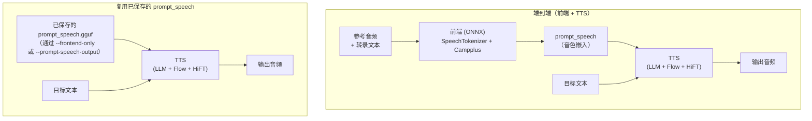

# CosyVoice.cpp

[](LICENSE)
[]()
[](https://github.com/Lourdle/cosyvoice.cpp/releases)
[](https://github.com/Lourdle/cosyvoice.cpp/actions/workflows/build-release.yml)

语言： [English](README.md) | 简体中文

> 非官方说明：本仓库**与 CosyVoice 官方团队无隶属关系**，也未获得官方背书或维护。本项目是社区开发者发起和维护的 C++/GGML 移植实现。

> **当前状态提示：** 当前 CPU、CUDA、Metal、Vulkan 和 SYCL 后端均可正常运行。用于生产前请先阅读[后端测试情况](#后端测试情况)。

本项目将原始 CosyVoice 项目发布的 Python 推理流程迁移到 C++/GGML，目前主要支持 **CosyVoice3**。

支持 **zero-shot**、**instruct** 和 **cross-lingual** 三种 TTS 模式，同时提供同步输出与**流式输出**（streaming）。前端流水线（speech tokenizer + speaker embedding）可处理参考音频，也可复用预编码的 `prompt_speech` 跳过 ONNX 前端以提升性能。

本项目提供：
- 核心 C/C++ 推理库（`cosyvoice`）
- 命令行合成工具（`cosyvoice-cli`）
- OpenAI Speech 兼容 API 服务，含嵌入式 WebUI（`cosyvoice-server`）
- GGUF 量化工具（`quantize`）

## 目录
- [功能特性](#功能特性)
- [快速开始](#快速开始)
- [基本用法](#基本用法)
- [预转换模型](#预转换模型)
- [推理流程](#推理流程)
- [后端测试情况](#后端测试情况)
- [故障排查](#故障排查)
- [文档](#文档)
- [AI 使用说明](#ai-使用说明)
- [第三方许可说明](#第三方许可说明)
- [许可证说明](#许可证说明)
- [欢迎贡献](#欢迎贡献)

## 功能特性

| 特性 | 说明 |
|---|---|
| **OpenAI Speech API 服务** | 即插即用的 `POST /v1/audio/speech` 端点，支持多音色、鉴权和 CORS——内置 **WebUI** 用于模型/音色管理和 TTS 生成 |
| **WebUI 仪表盘** | 现代化浏览器界面，支持运行时加载/卸载模型、注册音色（GGUF 导入/音频提取/麦克风录音）、TTS 生成（实时播放、历史记录、完整采样控制） |
| **交互式 REPL** | CLI 交互模式，支持 /play、/save、/list、/query、/seed 等斜杠命令 |
| **并发服务** | Server 的 `--concurrency` 参数，支持并行请求处理 |
| **推理中断** | CLI 中按 `Ctrl+C` 或断开 server 连接时尽快停止生成——截止点之前的输出仍然有效 |
| **模型量化** | 内置 `quantize` 工具，支持 Q2_K 到 F16 多种量化格式 |
| **流式 TTS** | 实时语音生成，通过回调逐段交付音频——在完整语句尚未合成完毕前即可开始播放 |
| **DiT KV 缓存** | 流式分块合成时，按扩散步缓存已产出位置的注意力 KV，新块只计算新增位置——可配置固定（设备内存）、可卸载（CPU）、不缓存三种槽位类型 |
| **Flash Attention** | LLM 与 Flow 模块均支持 flash attention（`--llm-flash-attn`、`--flow-flash-attn`），后端支持时可降低显存并加速推理 |
| **分块 Token 控制** | 通过 `--chunk-tokens` 调节流式推理的延迟与开销平衡——较小分块降低首块延迟，较大分块降低 RTF |
| **KV Cache 量化** | 通过 `--llm-kv-cache-type` 降低 LLM 内存占用（f32 / f16 / q8_0 / q5_1 / q4_0 / ...）。支持非对称量化，K 和 V 可独立指定类型（如 `k=q8_0,v=q4_0`）。 |
| **Prompt Speech 复用** | 一次编码参考音色，后续合成直接复用，无需再跑 ONNX |
| **音频后端可切换** | 可选 MINIAUDIO（默认）或 FFMPEG，支持 WAV、MP3、AAC、FLAC、OPUS、M4A |
| **UMA 检测** | 检测统一内存架构并报告结果（如 `uma: yes/no`）供参考；不会改变 buffer policy |
| **推理 Buffer 策略** | `shared` / `balanced` / `dedicated` 三种模式，权衡内存与吞吐 |
| **文本拆分与淡入** | 长文本智能拆分与可配置的输出淡入后处理 |
| **多后端支持** | CPU、CUDA、Metal、Vulkan、SYCL（见[后端测试情况](#后端测试情况)） |
| **自适应 SIMD 分派** | CPU DSP 热点按指令集分层编译（标量、SSE4.2、AVX、AVX2+FMA3、AVX-512、AVX10.1），运行时自动选择——见 [docs/SIMD_zh.md](docs/SIMD_zh.md) |
| **跨平台** | Windows (x64)、Linux (x86_64)、macOS (arm64) — 均在 CI 中测试 |

## 快速开始

### 预编译发布版 (Releases)

所有平台的发布包都只包含 `cosyvoice` 可执行文件与前端/音频依赖，**不捆绑 GGML**——GGML 从 `llama.cpp` release 获取：
1. 从本仓库的 [Releases 页面](https://github.com/Lourdle/cosyvoice.cpp/releases) 下载 `cosyvoice-cli` 或 `cosyvoice-server`。
2. 下载与硬件和操作系统匹配、且带有 **GGML 1.x**（v1.0.0，2026-11-13 起）的 `llama.cpp` release。
3. 把该 release 中的**全部** GGML 库拷贝到 `cosyvoice` 可执行文件所在目录——`ggml*.dll` / `libggml*.so*` / `libggml*.dylib`，**包含 CPU 变体模块**（`ggml-cpu-<isa>.dll`、`libggml-cpu-<isa>.so`）。后端在运行时从可执行文件所在目录被发现，缺少变体模块会导致二进制没有可用的 CPU 后端。
4. 在该目录下运行。macOS 上请用 `cp -a`（或直接解压）拷贝 dylib，以保留带版本号的符号链接链——`libggml.dylib` 是指向 `libggml.<版本>.dylib` 的符号链接。

自检方法：运行 `cosyvoice-cli --list-backends`，它会列出实际从该目录加载到的后端，打印出的名字正是 `--backend` 接受的值。如果列表为空、或缺少你要用的 GPU 后端，说明 GGML 库没放对位置或版本太老。

> **系统库：** `icu=ON` 与 `audio=FFMPEG` 变体会动态链接 `libicuuc`/`libicui18n` 与 `libav*`/`libswresample`，这些库已从发布包中剥离——请自行安装（或直接放到可执行文件旁）。`no_icu`、`miniaudio` 与 `no_audio` 变体除 GGML 外无其他依赖。

> **GGML 版本要求：** 请使用带有 **GGML 1.x** 的 `llama.cpp` release（GGML v1.0.0，2026-11-13 起）。GGML 1.0 剪除了废弃的公开 API，并把库 SONAME 升到 1（`libggml.so.1` / `libggml.1.dylib`），因此 0.x 的库与本构建不兼容：Linux/macOS 上因 SONAME 不匹配而加载失败；Windows 上虽能加载，但算子分派错误（GGML 1.0 移除了旧的 op 枚举项，剩余算子数值整体偏移），会崩溃或产生错误输出。这也覆盖了此前 macOS Metal 的要求——`GGML_OP_PAD` 内核需支持 beg（左侧）填充，上游已在 [ggml-org/llama.cpp#29561](https://github.com/ggml-org/llama.cpp/pull/29561) 加入，所有 1.x 构建均包含。

> **预编译 GGML CUDA 后端已知问题（Issue [#15](https://github.com/Lourdle/cosyvoice.cpp/issues/15)）：** 有用户反馈使用 `llama.cpp` 预编译发布版的 GGML CUDA 后端时，生成的音频存在噪音。测试确认了预编译 GGML CUDA 版本存在此问题，而自行从源码编译的 GGML 则未出现该问题。如果您在使用 CUDA 后端配合预编译 GGML 时遇到噪音，建议将本项目与 GGML 一同从源码编译。如果不想自行编译，也可以直接改用 **Vulkan 后端**——它与 llama.cpp 的预编译 GGML 发布包配合良好，开箱即用。

### 从源码构建

```bash
cmake -B build -DCMAKE_BUILD_TYPE=Release
cmake --build build --config Release
```

构建产物在 `build/bin`（可执行文件）和 `build/lib`（库文件）。详细构建选项、服务端特殊要求和后端配置见 [docs/BUILD_zh.md](docs/BUILD_zh.md)。

## 基本用法

```bash
# zero-shot TTS：前端 + TTS 一条命令完成
cosyvoice-cli --model model.gguf \
  --speech-tokenizer speech_tokenizer.onnx --campplus campplus.onnx \
  --prompt-audio ref.wav --prompt-text "参考文本" \
  --text "目标文本" --output out.wav

# 复用预编码的 prompt_speech（跳过 ONNX 前端）
cosyvoice-cli --model model.gguf --prompt-speech prompt_speech.gguf \
  --text "hello" --output out.wav

# 预编码 prompt_speech，供后续复用
cosyvoice-cli --frontend-only --speech-tokenizer speech_tokenizer.onnx \
  --campplus campplus.onnx --prompt-audio ref.wav \
  --prompt-text "参考文本" --prompt-speech-output prompt_speech.gguf

# 交互模式
cosyvoice-cli --model model.gguf --prompt-speech prompt_speech.gguf --interactive

# OpenAI 兼容 API 服务，含 WebUI
cosyvoice-server --model model.gguf \
  --voice-prompt alloy=prompt_alloy.gguf --host 0.0.0.0 --port 8080

# 量化 GGUF 模型
quantize -f model.gguf -o model-q4k.gguf -t Q4_K
```

完整命令、参数和示例见 [docs/TOOLS_zh.md](docs/TOOLS_zh.md)。

## 预转换模型

下载即用的 GGUF 模型（无需自行转换）：

- **ModelScope**：<https://modelscope.cn/models/Lourdle/Fun-CosyVoice3-0.5B-2512-GGUF>
- **Hugging Face**：<https://huggingface.co/Lourdle/Fun-CosyVoice3-0.5B-2512-GGUF>

上述链接包含 Q2_K 到 F16 的多种量化变体。如需自行转换上游模型权重，见 [docs/CONVERT_zh.md](docs/CONVERT_zh.md)。

## 推理流程

本项目支持两条等价推理路径：



- **路径 1（端到端）**：前端从参考音频 + 转录文本提取 `prompt_speech`，然后 TTS 与目标文本合成语音。
  - `zero-shot` 模式需要 `--prompt-text`；`instruct` / `cross-lingual` 模式忽略它。
- **路径 2（复用）**：通过 `--frontend-only` / `--prompt-speech-output` 运行一次前端，后续合成跳过 ONNX 模型。适合批量/重复合成。

流式 TTS、DiT KV 缓存与推理 Buffer 策略的详细说明见 [docs/STREAMING_zh.md](docs/STREAMING_zh.md)。

## 后端测试情况

当前各后端测试结果如下：

| 后端 | 状态 | 备注 |
|---|---:|---|
| CPU | 可运行 | 已在 Windows、Linux 和 Mac 上测试。 |
| CUDA | 可运行 | 已在 Ada Lovelace GPU (Windows & Linux) 上测试。 |
| Metal | 可运行 | 感谢 @[jasagiri](https://github.com/jasagiri) 的支持与代码贡献。 |
| SYCL | 可运行 | 已在 Windows 11 x64 上的 Intel Raptor Lake 集成显卡上验证。 |
| Vulkan | 可运行 | 在 NVIDIA Ada Lovelace GPU 与 Intel Raptor Lake 核显上验证通过。 |
| OpenCL | 可运行 | 在 Android 16、Qualcomm Snapdragon 8 Elite 上验证通过。OpenCL 后端缺失大量算子，需卸载到 CPU 运行，频繁切换计算后端导致上下文开支较大，相比 CPU 并未带来显著提速。 |
| 其它 | 未测试 | |

## 故障排查
- CMake 找不到 GGML：设置 `-DGGML_SOURCE_DIR=...`，或使用默认 `vendor/ggml` 并确保本机可用 Git（用于自动克隆）。另见 [docs/BUILD_zh.md](docs/BUILD_zh.md)。
- ICU/ONNX Runtime 检测失败：可安装系统包（适用平台），或将预编译文件放到 `<build_dir>/_deps/icu` 与 `<build_dir>/_deps/onnxruntime`。
- Windows 运行时缺库：检查 `build/bin` 下是否存在构建后复制的依赖 DLL。
- 运行时调优开关（SIMD 层级、权重缓冲大小、HiFT 日志、mel 导出）：见 [docs/ENVIRONMENT_zh.md](docs/ENVIRONMENT_zh.md)。
- 后端相关情况见[后端测试情况](#后端测试情况)。

## 文档
- **构建指南：** [docs/BUILD_zh.md](docs/BUILD_zh.md)
- **工具说明：** [docs/TOOLS_zh.md](docs/TOOLS_zh.md)
- **流式 TTS / DiT KV 缓存 / Buffer 策略：** [docs/STREAMING_zh.md](docs/STREAMING_zh.md)
- **模型转 GGUF：** [docs/CONVERT_zh.md](docs/CONVERT_zh.md)
- **环境变量：** [docs/ENVIRONMENT_zh.md](docs/ENVIRONMENT_zh.md)
- **API 索引：** [docs/API_zh.md](docs/API_zh.md)
- **SIMD 层级架构（开发者参考）：** [docs/SIMD_zh.md](docs/SIMD_zh.md)
- **开发者指南（工具/测试约定）：** [docs/DEVELOPING_zh.md](docs/DEVELOPING_zh.md)
- **Android 构建指南：** [docs/build-android_zh.md](docs/build-android_zh.md)
- **测试：** [tests/README.md](tests/README.md)

## AI 使用说明
- 核心库代码主要由作者手工实现。
- 工具（cli、quantize、server）和文档内容大多由 AI 协助撰写与整理。
- 仍可能存在少量错误或与实现不同步的情况；如有疑问请以源码与头文件为准，也欢迎提交 Issue/PR 纠正。

## 第三方许可说明
- 第三方依赖与改造代码的许可证信息见 [THIRD_PARTY_NOTICES.md](THIRD_PARTY_NOTICES.md)。

## 许可证说明
- **本仓库代码**：MIT（见 `LICENSE`）。
- **上游参考**：原始 CosyVoice 项目代码与模型为 Apache-2.0。
- **实现说明**：本仓库是基于模型架构与推理行为的独立 C++/GGML 重实现，并非官方 fork 或官方发布。
- **GGUF 模型产物**：发布的模型文件继续保持 Apache-2.0。下载链接见[预转换模型](#预转换模型)。
- **模型许可证文件**：[MODEL_LICENSE.md](MODEL_LICENSE.md)

## 欢迎贡献
欢迎提交 Issue 和 Pull Request，尤其是：
- 后端稳定性修复
- 跨平台正确性改进
- 性能与内存优化
- 文档与工具改进

如果根因在 GGML，请优先向上游 GGML 提交修复补丁。
